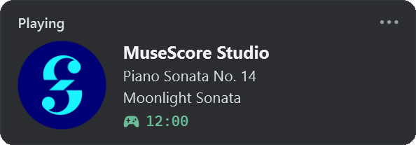

# MuseScore Rich Presence

Show the score you're working on in [MuseScore Studio](https://musescore.org) as your Discord Rich Presence.

  

The first line is the score's title, and by default the second is its subtitle. You can customize which details appear or rotate on the second line, turn on Private mode, and more from the app's **Settings** menu — see [Customization](#customization).

It runs alongside MuseScore Studio on Windows and macOS, with nothing to install inside MuseScore and no admin rights needed.

## Setup

Download the latest release for your OS from the [Releases](https://github.com/Mimsqueeze/musescore-rich-presence/releases) page:

### Windows

1. Download `MuseScore-Rich-Presence-win-x64.exe` and double-click it.
   - If Windows SmartScreen warns about an unrecognized app, click **More info** > **Run anyway**.
2. Choose **1. Install & start plugin at login** from the setup menu. It installs itself to `%LOCALAPPDATA%\MuseScore Rich Presence\`, sets up login startup, and starts silently.

### macOS

1. Download the `.dmg` for your Mac (`arm64` for Apple Silicon, `x64` for Intel), open it, and drag **MuseScore Rich Presence.app** into **Applications**.
   - Because the app is not notarized with an Apple Developer ID, macOS may block it on first launch. Right-click the app in Applications and click **Open** (or allow it in **System Settings > Privacy & Security**).
2. Pick **Install & Start Plugin at Login** from the prompt.
3. Grant permissions so it can read the active score:
   - Open **System Settings > Privacy & Security > Accessibility** and turn on **MuseScore Rich Presence**.
   - If macOS asks for access to your Documents folder (where scores live), allow that too.

### Managing the plugin

Re-open the app at any time to adjust **Settings**, start/stop the plugin, view logs, or uninstall it.

- Discord and MuseScore can be started in any order. When MuseScore closes, your status is cleared.
- With several MuseScore windows open, your status follows the one you used most recently. Each score keeps its own elapsed time, so switching back and forth doesn't reset it.

## Customization

Open the app at any time and choose **Settings** to customize your status. Changes save immediately and apply automatically while the plugin is running:

- **Second-line details** — Toggle any combination of details to show below the score title. When multiple are enabled, the second line rotates through them automatically (missing fields are skipped):
  - **Subtitle** *(default)* — e.g. `Moonlight Sonata`
  - **Part name** — e.g. `Violin 1 part` *(only while a part tab is open)*
  - **Composer** — e.g. `by Ludwig van Beethoven`
  - **Instruments** — e.g. `Piano` or `Violin ×2, Viola, Cello`
  - **Measures & time signature** — e.g. `184 measures · 4/4`
  - **Key signature** — e.g. `Key: E major / C♯ minor`
  - **Tempo** — e.g. `♩ = 54`
- **Rotation interval** — How often the second line rotates when multiple details are selected (default `15s`).
- **Private mode** — Hide all score details and show `Composing` instead.
- **Activity name** — Change the name shown after "Playing" (default `MuseScore Studio`).
- **Reset to defaults** — Restore default settings at any time.

## How it works

Everything is read from outside MuseScore:

1. **Which score is open.** MuseScore Studio sets its window title to the open score's name (`Score`, `Score - Part` in a part tab, or `MuseScore Studio` on the Home screen).
   - On Windows, the title is read with `tasklist`, which works even when MuseScore runs elevated. A small PowerShell helper ([src/foreground.ps1](src/foreground.ps1)) watches which window is in front, so the status can follow the MuseScore window you're using.
   - On macOS, small JavaScript for Automation helpers run through `osascript` do the same jobs. [src/windows.jxa](src/windows.jxa) reads the title through System Events, and [src/foreground.jxa](src/foreground.jxa) watches which app is in front.
2. **Where that score lives.** The title is matched against MuseScore's own `session/session.json` and `recent_files.json`. These are in `%LOCALAPPDATA%\MuseScore\MuseScore4` on Windows and `~/Library/Application Support/MuseScore/MuseScore4` on macOS. This resolves the full path wherever your scores are, including OneDrive or iCloud folders, and also covers cloud scores.
3. **Score details.** The `.mscz` file is a zip archive. The score XML inside it is read to get the title, subtitle and composer from the title frame at the top of the score, plus the instruments, measures, time and key signatures, and tempo. If the title frame has several lines, the one in the largest font is used as the title. Results are cached and refreshed whenever you save.

Because the details come from the saved file, edits show up in your status after you save. Switching scores updates it right away.

## Limitations

- Windows and macOS only. Linux isn't supported yet.
- On macOS, System Events lists only the windows on the current Space. If MuseScore is on another Space, the status keeps showing the last score seen there until you return to it.
- Discord shows one status per app, so with several MuseScore windows open, only the most recently used one is shown.
- A new score that hasn't been saved yet shows only its name.
